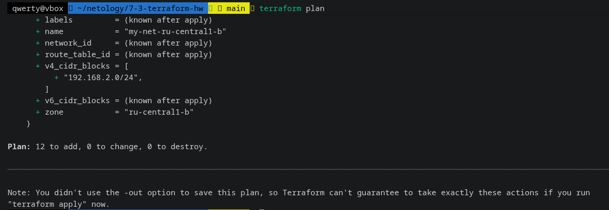
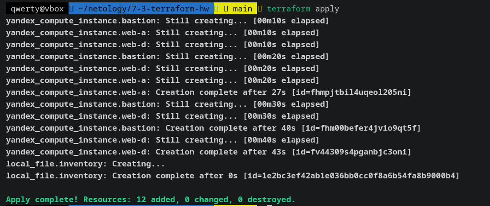
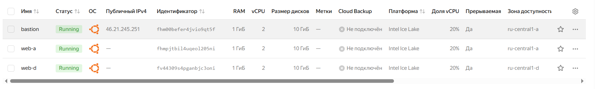
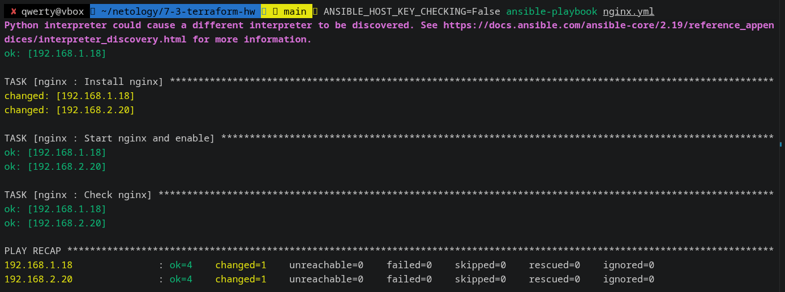
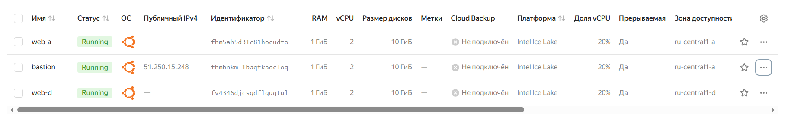
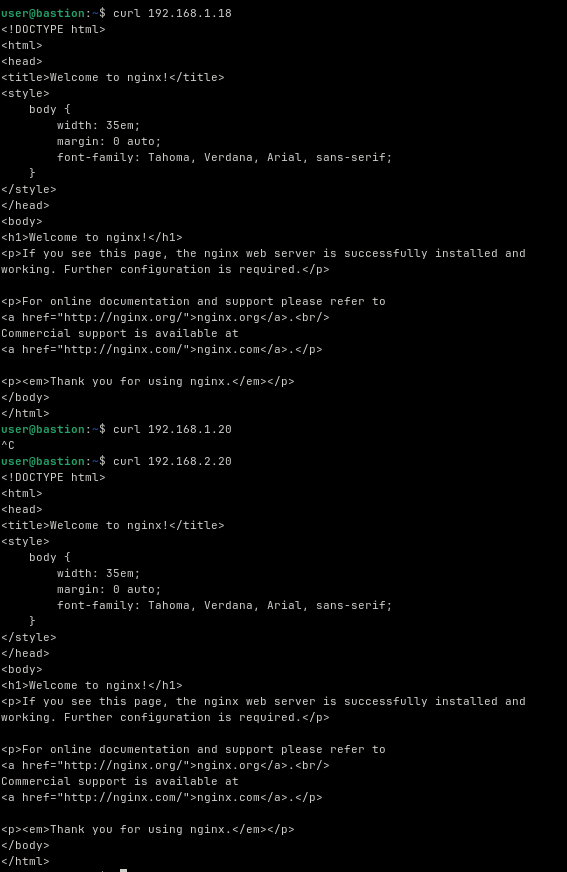
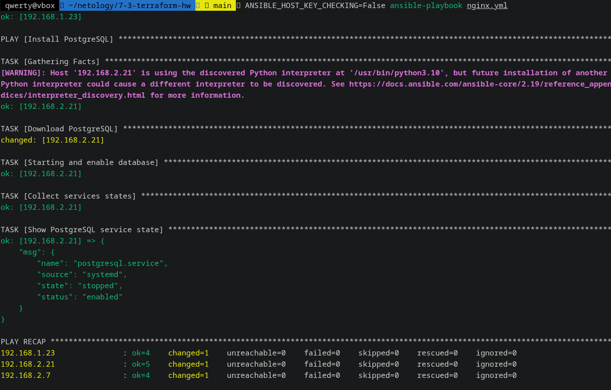
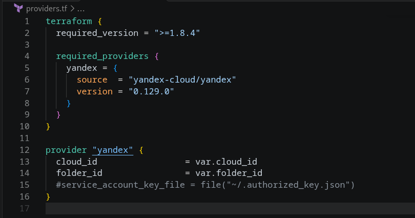
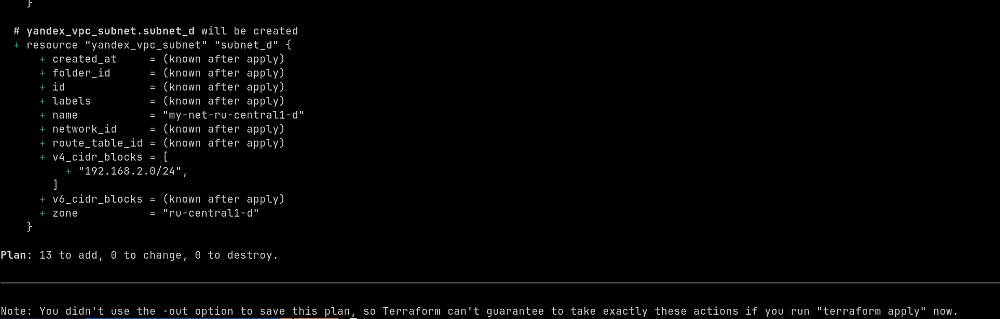
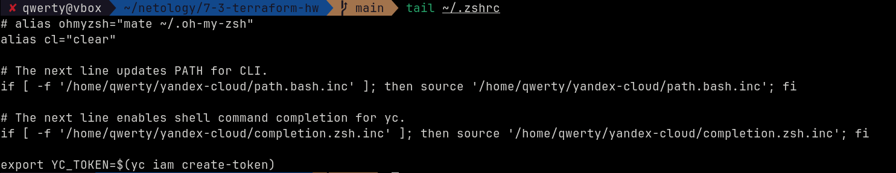

# Домашнее задание к занятию "Подъем инфраструктуры в облаке" - Качьянов Вадим

### Задание 1

С помощью terraform была поднята инфраструктура из лекции: VPC с двумя подсетями, NAT-шлюз, бастион и 2 веб-сервера. Весь код лежит в репозитории.

1) terraform plan

2) terraform apply

3) Поднятые ВМ в облаке

### Задание 2

Для установки nginx на web-a и web-b была написана роль nginx, которую вызывает playbook nginx.yml. Подключение к веб-серверам идёт через бастион.

1) Выполнение playbook

2) ВМ в облаке

3) Проверка nginx с бастиона

### Задание 3*

Была добавлена ВМ с PostgreSQL, проверка состояния службы сделана через модуль service_facts.

### Задание 4*

Из провайдера убрана авторизация, токен передаётся через переменную окружения YC_TOKEN. Команда для получения токена добавлена в ~/.zshrc, так как у меня zsh.

1) providers.tf

2) terraform plan с токеном из переменной окружения

3) ~/.zshrc

